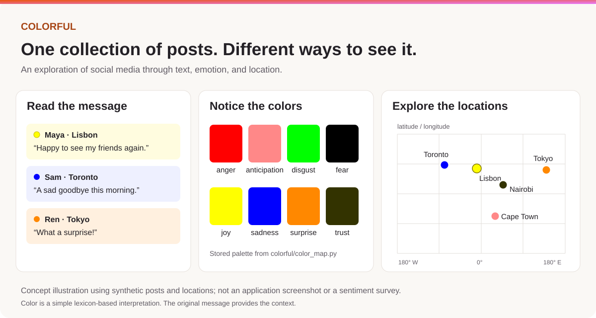

# Colorful

Colorful is an exploration of how social media could represent what people are feeling through color and location. Users share short updates, and the application uses emotion words in those updates to assign a color.

The same posts can be read in a feed, viewed together as a grid, or explored geographically on a map.



*Text, color, and location views illustrated with synthetic posts. Colors follow the application's emotion palette.*

## Motivation

Most social media applications organize posts around a feed. We wanted to explore other ways of viewing the same information.

What changes when you see a collection of feelings as colors rather than a list of messages? Can a map help connect people in different places? What becomes easier to notice, and what gets lost when individual experiences are summarized this way?

Colorful was built to experiment with those questions. The goal was to explore different types of social media applications and different ways of connecting people and viewing global sentiment. Text, color, and geography each provide a different way into the same collection of posts.

## Different ways to view a post

- **The feed** preserves the message and its context.
- **The grid** brings the colors together so patterns can be seen across users. Hovering over a square reveals the message; clicking opens the user's profile.
- **The map** places posts geographically, adding another way to explore what people are sharing.
- **Profiles and following** provide a way to return to particular people. The feed, grid, and map can be filtered to all users or followed users.

Each view brings together users' latest updates, offering a different way to explore the same posts.

## How it works

The application uses Python and Flask, with SQLAlchemy and SQLite for user accounts, posts, and follow relationships. The interface uses JavaScript, Tailwind CSS, and Alpine.js. The geographic view uses Google Maps.

When someone posts an update, [LeXmo](https://github.com/dinbav/LeXmo) compares its words with the NRC Emotion Lexicon. Colorful selects the highest-scoring emotion from eight categories: anger, anticipation, disgust, fear, joy, sadness, surprise, and trust. The corresponding color is stored with the post and used across the different views.

Color adds a way to explore posts at a glance, while the text preserves the message behind each update.

The main parts of the project are:

- [Application setup](colorful/__init__.py) and [database models](colorful/db.py)
- [Emotion and color mapping](colorful/color_map.py)
- [Status and social API](colorful/api/routes.py)
- [Page templates](colorful/templates/app) and [browser interactions](colorful/static/scripts)

## Quick start

Use Python 3.12. The commands below are for macOS or Linux; Windows commands are included where they differ.

### 1. Install

```sh
git clone https://github.com/TheDeafOne/Colorful.git
cd Colorful
python3.12 -m venv .venv
source .venv/bin/activate
python -m pip install -r requirements.txt
python -m nltk.downloader -d .venv/nltk_data punkt punkt_tab
export NLTK_DATA="$PWD/.venv/nltk_data"
```

On Windows, create the environment with `py -3.12 -m venv .venv`, activate it with `.venv\Scripts\Activate.ps1`, and set `$env:NLTK_DATA = "$PWD\.venv\nltk_data"` in PowerShell. The remaining Python commands are the same.

### 2. Configure

Copy `.env.template` to `.env`. Generate a password-encryption key:

```sh
python -c "from cryptography.fernet import Fernet; print(Fernet.generate_key().decode().rstrip('='))"
```

Paste the result into `PEPPER_KEY` in `.env`. The application adds the final padding character itself, which is why the command removes it. Keep this key when reusing an existing database.

```dotenv
PEPPER_KEY='paste-the-generated-value-here'
RELOAD_DB='False'
MAPS_API_KEY=''
```

For the map view, put your own Google Maps JavaScript API key in `MAPS_API_KEY` and allow your local address in its referrer settings. The feed and grid do not require this key.

Flask's session secret is configured in [create_app()](colorful/__init__.py).

### 3. Run

```sh
python application.py
```

Open [http://127.0.0.1:5000](http://127.0.0.1:5000), register an account, and sign in. The SQLite database is created automatically at `colorful/users.sqlite3`. Allow location access when posting to place your update on the map.

Keep `RELOAD_DB` set to `False` for normal use. Set it to `True` to rebuild the database on startup with randomized sample users, posts, locations, and colors.

LeXmo fetches its lexicon when processing text. If posting fails because language resources cannot be reached, check network access and that `NLTK_DATA` is set in the shell used to start the application.
